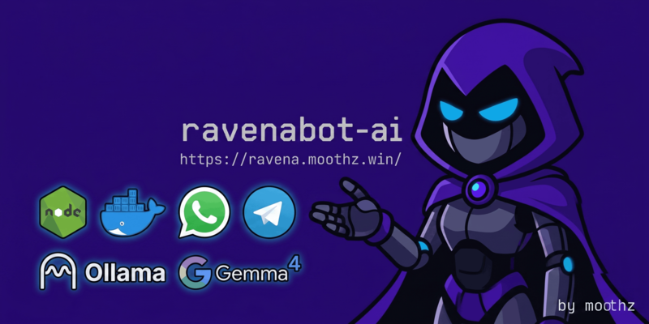

# RavenaBot AI



> Bot multifuncional para WhatsApp, Telegram e Discord, totalmente conteinerizado via **Docker** e construído com arquitetura modular, APIs modernas (whatsmeow / WhatsGoAPI) e integração nativa com Inteligência Artificial.

---

## 🔮 Sobre o Projeto

A **RavenaBot** foi desenvolvida para potencializar a dinâmica de grupos e canais:
- **Automação e Moderação:** Boas-vindas, despedidas, filtros de palavras, links e quarentena de conteúdo NSFW.
- **Mídia e Criação:** Geração de stickers estáticos e animados, conversão de formatos (áudio/vídeo/GIF) e download de plataformas (YouTube, TikTok, Instagram).
- **Gamificação e Coleção:** Sistema de harém/gacha (*Waifuletes*), pescaria de peixes lendários, cassino (slots/roleta) e jogos de palavras (anagrama/stop).
- **Streaming:** Notificações automáticas em tempo real de lives da Twitch, Kick e YouTube.
- **Inteligência Artificial:** Resumo de mensagens, transcrição de voz (Whisper/F5-TTS), OCR e respostas inteligentes via LLMs (Gemini, Claude, GPT, Ollama).

### 🌐 Use a Ravena agora!
Você pode testar a Ravena acessando o site oficial em [**ravena.moothz.win**](https://ravena.moothz.win) ou enviando uma mensagem no WhatsApp diretamente para uma das instâncias:
- **Ravena 2:** [+55 (98) 8771-5450](https://wa.me/559887715450)
- **Ravena 5:** [+55 (55) 9153-7296](https://wa.me/555591537296)
- **Ravena 10:** [+55 (55) 8102-4412](https://wa.me/555581024412)

---

## 🤖 Dúvidas e Suporte com Agentes de IA

O repositório possui uma documentação técnica completa consolidada no arquivo:
👉 **[`docs/LLM-HELPER.md`](docs/LLM-HELPER.md)**

> [!TIP]
> **Como tirar dúvidas instantâneas sobre qualquer recurso:**
> 1. Baixe ou abra o arquivo [`docs/LLM-HELPER.md`](docs/LLM-HELPER.md).
> 2. Anexe-o como contexto em qualquer modelo de IA (ChatGPT, Claude, Gemini, AnythingLLM, OpenRouter).
> 3. Pergunte sobre qualquer comando, parâmetros, variáveis de comandos personalizados (`{API#...}`, `{mention}`) ou regras de configuração. A IA responderá como um especialista no código da Ravena.

---

## 🚀 Como Hospedar (Quickstart)

> **Requisito mínimo:** [Docker](https://docs.docker.com/engine/install/) e [Docker Compose](https://docs.docker.com/compose/install/) instalados na máquina.

A Ravena foi disponibilizada em Docker para facilitar a instalação, mas muitas partes dela ainda rodam em "módulos" que devem ser hospedados separadamente. A grande maioria dos comandos não precisa de módulos/APIs externas, mas notoriamente qualquer comando que use IA (interações, resumos, geração de imagens, geração de voz, transcrição, etc.) e também alguns jogos (waifuletes/mudae e fazenda) vão precisar de configuração no arquivo `.env`.

Se você pedir pra um agente de IA (Antigravity, Codex, Claude, etc.), ele vai facilmente ler o repositório e te guiar nestas partes.

### 1. Clonar o repositório
```bash
git clone --recurse-submodules https://github.com/moothz/ravena-ai.git
cd ravena-ai
```

### 2. Configurar o ambiente
```bash
# Gera o arquivo .env inicial com segredos seguros
make setup

# Configura as instâncias de bots
cp bots.json.example bots.json

# (Opcional) Configura provedores adicionais de IA/Voz
cp service-providers.json.example service-providers.json
```
> Edite o `.env` para informar o número do seu WhatsApp em `SUPER_ADMINS` e defina os parâmetros do seu bot no `bots.json`.

### 3. Iniciar a aplicação
```bash
make up-build
```

### 4. Conectar ao WhatsApp
Acesse a interface web para ler o QR Code ou código de pareamento:
```
http://localhost:5001/qrcode/<nome-do-bot>
```
*(Utilize o usuário e senha definidos em `managementUser` e `managementPW` no `bots.json`)*.

---

## 🔌 Dependências Externas & APIs

A Ravena conta com uma arquitetura modular que permite estender suas funcionalidades através de APIs e serviços externos. Esses serviços podem ser configurados no arquivo `service-providers.json` (ou no `.env` em integrações específicas) ou gerenciados dinamicamente via painel web no endpoint `/service-providers` da API do bot.

As dependências dividem-se em duas categorias principais:

- **APIs prontas de fornecedores:** Provedores de nuvem prontos para uso através de chave de API (OpenAI, Google Gemini, OpenRouter, DeepSeek, além de serviços como OpenWeather, Twitch, Kick, etc.).
- **APIs com repositório para auto-hospedagem (Self-Hosted):** Microsserviços com repositórios fornecidos para hospedagem própria:
  - **Whisper (STT):** [moothz/faster-whisper-api](https://github.com/moothz/faster-whisper-api) — Transcrição de áudio e mensagens de voz em alta velocidade.
  - **laya-api:** *(Em breve)* — Classificação ultra-rápida de intenções, embeddings e System One.
  - **bonsai-api:** *(Em breve)* — Geração de imagens via difusão e arte generativa.
  - **f5-tts:** *(Em breve)* — Síntese de voz neural (Text-to-Speech) e clonagem vocal.

👉 Para uma explicação detalhada sobre o que faz cada API, como configurá-las passo a passo e quais partes do código as utilizam, consulte: **[`docs/EXTERNAL-APIS.md`](docs/EXTERNAL-APIS.md)**.

---

## 📚 Documentação Técnica Adicional

- 📖 **[Manual de Comandos e IA (LLM-HELPER)](docs/LLM-HELPER.md)**: Relação exaustiva de mais de 70 módulos de comandos e variáveis personalizadas.
- 🤝 **[Guia de Contribuição e Testes](CONTRIBUTING.md)**: Padrões de código, ESLint e uso do harness `FakeBot` / `FakeMessage`.
- 🛠️ **[Automação e Comandos do Makefile](docs/MAKEFILE.md)**: Guia completo e detalhado com todas as tarefas de build, inicialização, testes, gerenciamento de instâncias e manutenção via Makefile.
- 🔌 **[Dependências Externas & APIs](docs/EXTERNAL-APIS.md)**: Documentação completa sobre configuração de provedores de IA, APIs auto-hospedadas e integrações do ecossistema.
- 🗄️ **[Estrutura de Banco de Dados](DATABASES.md)**: Mapeamento de tabelas SQLite e PostgreSQL.

---

## 📝 Licença

Distribuído sob licença livre. Sinta-se à vontade para utilizar, modificar e expandir.
